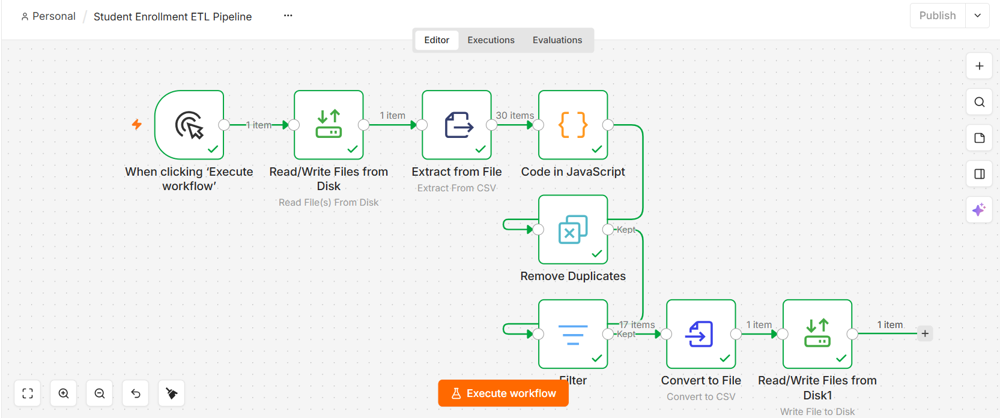
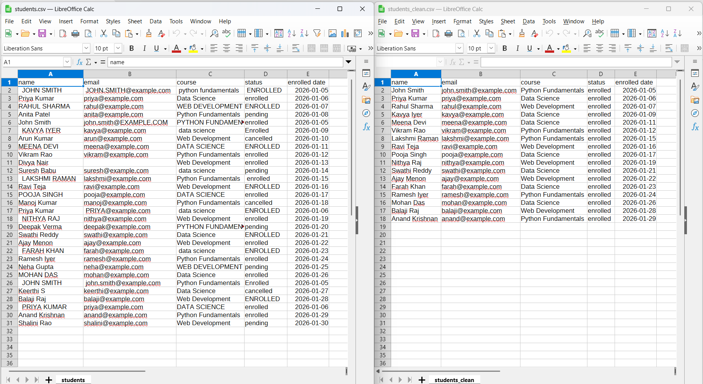

# Student Enrollment ETL Pipeline using n8n

A practical n8n workflow that cleans messy student enrollment data and exports a consistent CSV file.

## Workflow Preview

The workflow reads a CSV, standardizes fields, removes duplicate email addresses, filters records, and writes the resulting data to a new CSV file.

## Before and After

## Features

- Reads student records from a CSV file.
- Trims leading and trailing whitespace.
- Standardizes student and course names to title case.
- Converts email addresses to lowercase.
- Normalizes enrollment status to lowercase.
- Removes duplicate records using the normalized email address.
- Keeps records with status `enrolled` and a non-empty email address.
- Exports the retained records to a CSV file.

## Data Cleaning Rules

- **Names and courses:** Trim whitespace and convert to title case.
- **Emails:** Trim whitespace and convert to lowercase.
- **Status:** Trim whitespace and convert to lowercase.
- **Duplicate definition:** Records with the same normalized email address are considered duplicates.
- **Missing email:** Records with an empty email are excluded by the filter.
- **Filter rule:** Keep records where `status` equals `enrolled` and `email` is not empty.

## Project Files

| File | Description |
|---|---|
| `students.csv` | Messy input data |
| `students_clean.csv` | Cleaned output generated by the workflow |
| `Student Enrollment ETL Pipeline.json` | Exported n8n workflow |
| `Student-Enrollment-ETL-Pipeline.png` | Workflow canvas screenshot |
| `csv-comparison.png` | Before-and-after CSV screenshot |

## Requirements

- Windows
- n8n 2.35.7 or a compatible version
- Read/write filesystem access configured for the n8n process

## Setup and Run

1. Import `Student Enrollment ETL Pipeline.json` into n8n.
2. Update the file paths in both **Read/Write Files from Disk** nodes for your environment.
3. Ensure n8n is allowed to read the input file and write the output file.
4. Open the workflow and click **Execute workflow**.
5. Confirm that every node succeeds.
6. Open `students_clean.csv` and verify the output records.

The current workflow uses the input and output files in n8n's permitted directory. Update those paths if you move the files or import the workflow on another machine.

## Verification Results

The recorded run produced the following counts:

| Stage | Records |
|---|---:|
| Input CSV | 30 |
| After deduplication | 26 |
| Removed as duplicates | 4 |
| Kept after filtering | 17 |
| Excluded by filtering | 9 |
| Final output CSV | 17 |

The filter retains records with `status` equal to `enrolled` and a non-empty email address.

## Implementation Notes

The transformation and filtering are deterministic and do not require an LLM or an API key. The workflow uses n8n nodes to read, extract, transform, deduplicate, filter, and write the CSV data.
